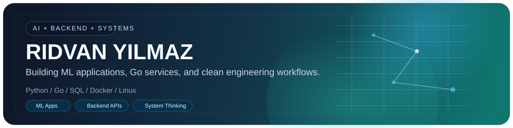

  

  <strong>Computer Engineering graduate focused on AI-backed backend systems.</strong>

  Python · Go 

  <a href="mailto:ridvanyilmaz333@gmail.com">Email</a>
  ·
  Istanbul, Turkiye

I build practical systems around data, APIs, and backend workflows. My main interest is turning ideas into usable engineering outputs: preparing data well, keeping the model or logic simple, and making the result reproducible enough to run locally without guesswork.

<table>
  <tr>
    <td valign="top" width="50%">
      <strong>What I focus on</strong>
      <ul>
        <li>AI and ML applications from data preparation to evaluation and lightweight deployment</li>
        <li>Backend development with Go and Python</li>
        <li>API design, service thinking, and clean local development workflows</li>
        <li>Operating systems, networking, and computer science fundamentals</li>
      </ul>
    </td>
    <td valign="top" width="50%">
      <strong>What supports that direction</strong>
      <ul>
        <li>Hands-on work with Docker, PostgreSQL, SQLite, Linux, and Git/GitHub</li>
        <li>A habit of documenting projects, tradeoffs, and operational details rather than shipping only surface-level demos</li>
        <li>Consistent practice through backend, automation, and product-oriented experiments</li>
        <li>Continued focus on reproducible local setups and stronger engineering fundamentals</li>
      </ul>
    </td>
  </tr>
</table>

## Featured work

<table>
  <tr>
    <td valign="top" width="50%">
      <a href="https://github.com/rdvn-ylmz/Persona-Worlds"><strong>Persona-Worlds</strong></a>
       
      Go-based MVP with API, worker, Postgres, frontend, observability notes, and runbooks.
       
      Signals: backend structure, ops thinking, production-readiness mindset.
    </td>
    <td valign="top" width="50%">
      <a href="https://github.com/rdvn-ylmz/codex-multi-agent-game-team"><strong>codex-multi-agent-game-team</strong></a>
       
      Python workspace for role-based multi-agent orchestration in a terminal-first workflow.
       
      Signals: automation, tooling, orchestration, iteration speed.
    </td>
  </tr>
</table>

## Current build direction

- Preparing a football match outcome prediction project for a cleaner public presentation
- Improving backend depth with Go and Python through small but complete systems
- Strengthening systems knowledge through networking and operating systems fundamentals

  
<strong>How to read this profile</strong>

   
  This GitHub is intentionally shaped around growth rather than volume.
  Some repositories are learning-oriented, some are experimental, and a smaller set are the ones that best represent where I am heading.
  The pattern I care about is simple: clear direction, stronger engineering judgment, and steady improvement over time.

